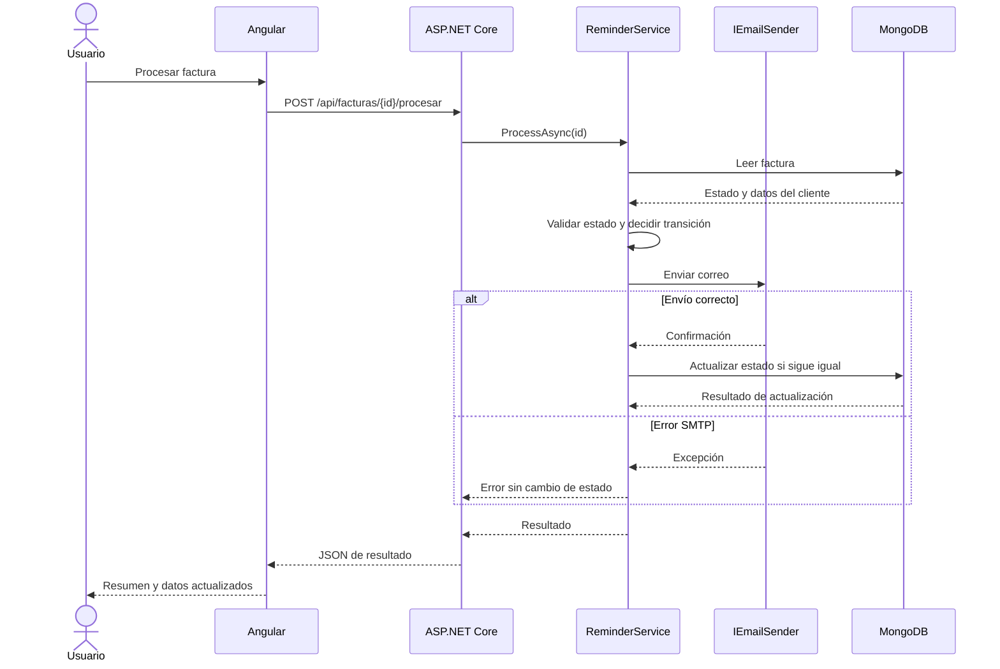

# Arquitectura y criterios técnicos

## Capas

1. **Presentación (Angular):** panel de indicadores, filtros, tabla, estados visibles y diálogo de resultados. No contiene reglas de transición.
2. **API (ASP.NET Core):** `FacturasController` expone endpoints REST y delega la lógica en `IReminderService`.
3. **Aplicación / dominio:** `ReminderService` valida estados, construye el mensaje, solicita el envío y solo entonces solicita persistir el cambio.
4. **Infraestructura:** `MongoFacturaRepository` encapsula consultas/actualizaciones MongoDB; `SmtpEmailSender` encapsula SMTP y el modo de simulación.

## SOLID y Clean Code

- **SRP:** el controlador atiende HTTP, el servicio coordina el caso de uso, el repositorio persiste y el remitente envía correo.
- **OCP:** los servicios dependen de interfaces; el remitente puede sustituirse por otro proveedor sin cambiar el caso de uso.
- **LSP / ISP:** interfaces pequeñas (`IFacturaRepository`, `IEmailSender`, `IReminderService`) con contratos concretos.
- **DIP:** el servicio de recordatorios depende de abstracciones inyectadas por el contenedor de ASP.NET Core.
- Nombres explícitos, métodos acotados, configuración externa y manejo explícito de errores.

## Secuencia de procesamiento

## Matriz de pruebas

| Caso | Resultado esperado |
|---|---|
| Primer recordatorio y correo exitoso | `segundorecordatorio` |
| Segundo recordatorio y correo exitoso | `desactivado` |
| Error SMTP | Estado original sin cambios |
| Factura desactivada | No se envía correo |
| Factura inexistente | Resultado de no encontrado |
| Cambio concurrente de estado | No sobrescribir el estado cambiado |
